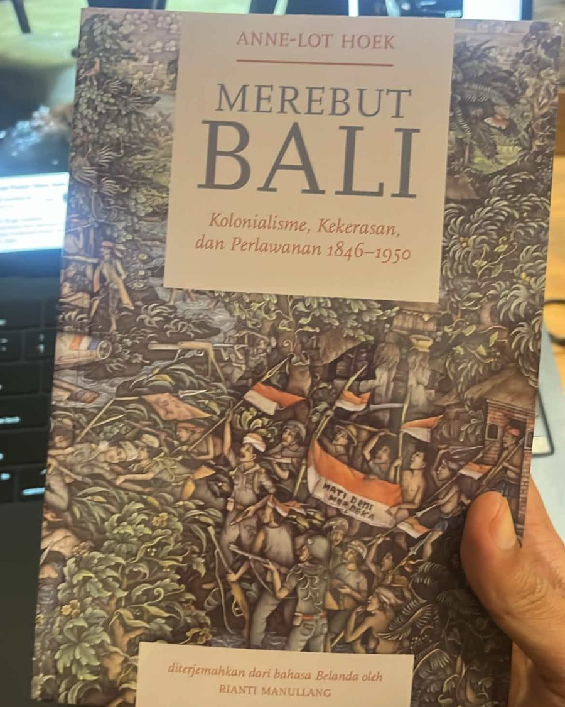

Belakangan ini aku sedang membaca *Merebut Bali*, karya Anne-Lot Hoek. Aku mulai mencari tahu tentang dia waktu UWRF bulan lalu, saat edisi bahasa Indonesianya diluncurkan, dan setelah itu namanya beberapa kali lewat di media sosialku. Hoek orang Belanda. Ia sudah meneliti sejarah Bali sejak 2011, dan bolak-balik ke sini. Aku sendiri baru pindah ke Bali Maret 2021. Dia jauh lebih lama "di Bali" daripada aku.

Karena penasaran, akhirnya aku beli bukunya di [Partikular](https://penerbitpartikular.com), toko buku di Denpasar yang raknya berisi buku penerbit indie dan rajin bikin diskusi dengan narasumber dan topik macam-macam. Aku menyebutnya cool kalcer kodya. Aku sudah beberapa kali ke sana, tapi kali ini aku pesan lewat chat ke Juli, salah satu pengelolanya. Ternyata pesananku baru bisa diurus setelah jam enam sore, karena tokonya memang baru buka jam segitu. Belakangan aku tahu Juli punya pekerjaan lain di siang hari, jadi toko itu ia urus setelah jam kerja. Apa tidak capek, ya.

*Merebut Bali, terjemahan Rianti Manullang dari bahasa Belanda.*

Bukunya tebal, lebih dari 800 halaman, tentang kekerasan dan perlawanan di Bali dari 1846 sampai 1950. Untuk menulisnya, selain membaca arsip kolonial, Hoek mewawancarai lebih dari seratus saksi mata di Bali. Aku belum jauh membacanya. Tapi di prakatanya, Hoek menulis bahwa sejarah lisan sering diremehkan dalam catatan kolonial. Padahal cerita dari mulut ke mulut bisa menambal titik buta arsip, dan memperlihatkan sejarah dari bawah, dari orang-orang yang tidak pernah menulis apa-apa.

Bagian itu membuatku teringat Mbah, nenekku.

Waktu kecil, aku, ibu, dan Mbah tinggal serumah. Mungkin karena itu, dibanding cucu yang lain, aku merasa paling dekat dengan Mbah. Sepulang sekolah, setelah makan dan beres-beres pekerjaan rumah, biasanya aku ikut Mbah rebahan di kamar, atau duduk-duduk di teras. Kalau tidak, ya malam hari, mendengarkan cerita sebelum tidur.

Cerita kancil nyolong timun sudah bosan aku dengar, dan makin besar makin terasa tidak relevan. Jadi aku minta cerita lain. Cerita Mbah biasanya berkisar di tiga hal: masa kecilnya, cerita horor, dan cerita receh soal tetangga. Yang pertama itu, baru sekarang aku sadar, sebenarnya sejarah.

Salah satunya soal bromokoso. Aku ingat sekali pertama kali mendengar kata itu. Rumahku di Ponorogo lumayan di kota, dekat jalan utama yang dilewati pawai agustusan, jadi suara sound system dan pengeras suaranya terdengar sampai ke rumah. Aku malas jalan dan berdesak-desakan menonton di pinggir jalan, jadi aku di rumah saja bersama Mbah, yang matanya sudah katarak. Di situ Mbah bercerita, dulu juga ada pawai, namanya bromokoso, untuk ulang tahun Ratu Wihelmina. Mbah menyebutnya begitu, Wihelmina. Ceritanya semangat sekali. "Guede," katanya, sambil tangannya bikin bulatan besar di udara, bibirnya ikut monyong membulat. Dari ceritanya, bromokoso itu semacam wahana yang berjalan dan dihias macam-macam. Aku penasaran sekali, sampai membayangkan seperti apa ulang tahun ratu Belanda di Ponorogo. Kata bromokoso itu sudah aku cari ke mana-mana, dan tidak ketemu.

Cerita soal Jepang keluar karena aku pancing. Suatu siang sepulang sekolah, habis dapat pelajaran sejarah tentang pendudukan Jepang, aku bertanya, "Mbah, jaman dhisik iku tentara Jepang sampe kene gak yo?" Lalu Mbah bercerita. Waktu kecil, katanya, ia ikut Fujinkai, barisan perempuan bentukan Jepang. Katanya waktu itu sedang pagebluk. Orang makan seadanya, dedak atau remahan beras sisa tumbukan, semacam itu, aku sudah lupa persisnya. Belakangan aku baca, di tahun-tahun terakhir pendudukan Jepang [memang ada kelaparan di Jawa](https://journal.ugm.ac.id/lembaran-sejarah/article/view/59909), dan petani dipaksa menyetor padi. Mbah juga masih hafal sedikit lagu kebangsaan Jepang.

Agak halu, sih. Tapi lama-lama aku perhatikan, cerita Mbah diulang berkali-kali, dan isinya selalu konsisten. Tidak ada dokumen atau foto, cuma cerita Mbah.

Belakangan aku perhatikan, buku Hoek ini juga memancing beberapa komunitas literasi bikin tulisan dan konten. Nadanya kurang lebih sama: selama ini sejarah kita ditulis dengan sudut pandang Jawa, padahal daerah di luar Jawa juga kena dampak kolonialisme yang besar. Semacam refleksi bersama. Ponorogo memang di Jawa. Tapi menurutku, sejarah biasanya juga cuma mencatat kota-kota besar yang dianggap penting. Kota kecil seperti Ponorogo jarang masuk, kecuali lewat cerita orang-orang seperti Mbah.

Hoek mewawancarai lebih dari seratus saksi untuk bukunya. Aku punya satu, dan sudah mendengar ceritanya berkali-kali.

---

### Sumber

- Foto sampul: [kereta hias untuk ulang tahun ke-50 Ratu Wilhelmina, Yogyakarta, 1930](https://digitalcollections.universiteitleiden.nl/view/item/888133). Bukan di Ponorogo. Koleksi KITLV, Leiden University Libraries (public domain).
- Pierre van der Eng (2020), [Peraturan dan Pengendalian: Menjelaskan Penurunan Produksi Pangan di Jawa 1940-1946 dan Kelaparan 1944-1945](https://journal.ugm.ac.id/lembaran-sejarah/article/view/59909), Lembaran Sejarah, UGM
- [Penerbit Partikular](https://penerbitpartikular.com)
